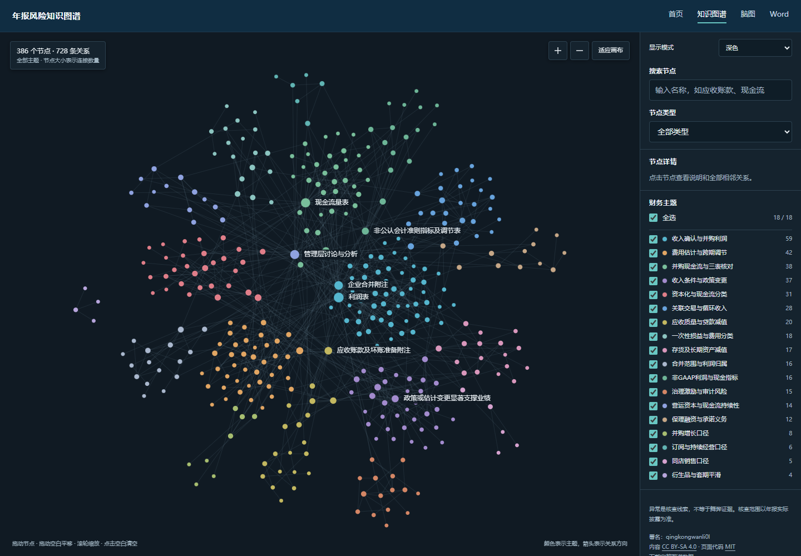
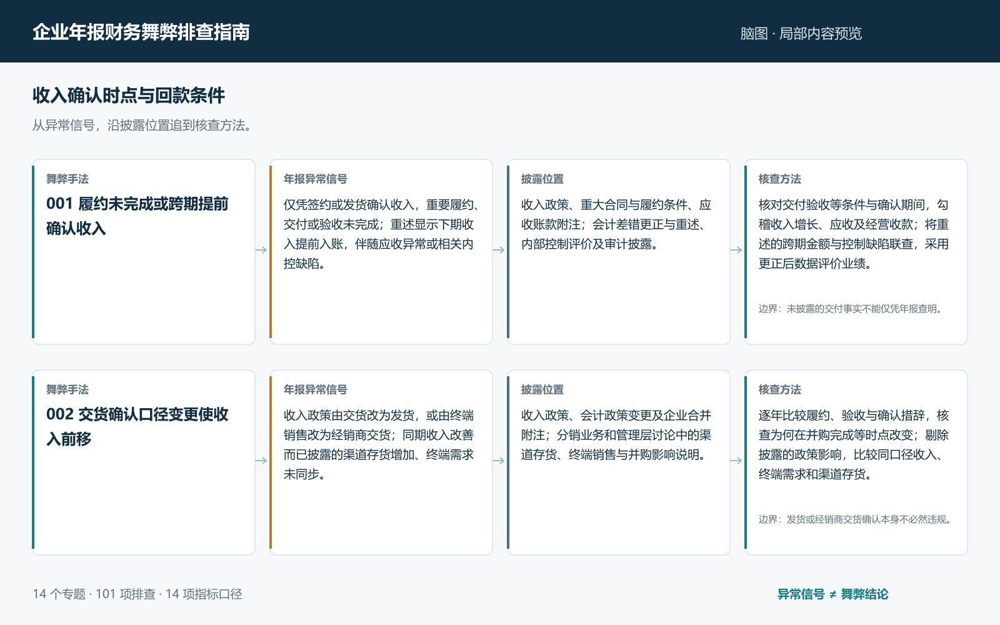

# 企业年报财务舞弊排查指南

从异常信号出发，把财务报表、附注与经营披露连起来阅读。

本项目围绕企业年报中的财务舞弊风险，提供知识图谱、排查脑图和 Word 指南。每条排查路径遵循 **舞弊手法 → 年报异常信号 → 披露位置 → 核查方法**，并保留必要的适用条件。

[进入项目网站](https://qingkongwanli0l.github.io/annual-report-fraud-guide/) · [知识图谱](https://qingkongwanli0l.github.io/annual-report-fraud-guide/graph.html) · [排查脑图](https://qingkongwanli0l.github.io/annual-report-fraud-guide/mindmap.html) · [Word 指南](https://qingkongwanli0l.github.io/annual-report-fraud-guide/guide.html)

## 知识图谱

**386 个知识节点 · 728 条关系 · 18 个主题**

默认展示全部节点与连线，按财务主题着色，节点大小体现连接数量。侧栏支持主题多选、全选与取消全选，也可按节点类型筛选。搜索或点击节点即可查看业务解释与完整关联，支持节点拖动、画布平移、缩放和明暗切换。

[在线浏览知识图谱](https://qingkongwanli0l.github.io/annual-report-fraud-guide/graph.html) · [下载离线网页](https://raw.githubusercontent.com/qingkongwanli0l/annual-report-fraud-guide/main/docs/graph.html) · [下载图谱数据](docs/downloads/graph.json)

## 排查脑图

**14 个专题 · 101 条排查条目 · 14 项指标速查**

按专题逐层展开手法、信号、披露位置与核查方法。支持关键词搜索、分支展开与折叠，适合快速定位和逐项复核；Markdown 文件可导入 XMind 继续整理。

[在线浏览排查脑图](https://qingkongwanli0l.github.io/annual-report-fraud-guide/mindmap.html) · [下载离线网页](https://raw.githubusercontent.com/qingkongwanli0l/annual-report-fraud-guide/main/docs/mindmap.html) · [下载 Markdown](docs/downloads/mindmap.md)

## Word 指南

将全部排查条目编排为四栏对照表，配有指标速查和适用条件。可直接在线阅读全文，也可另行下载 Word 文件进行批注和打印。

[在线阅读 Word 指南](https://qingkongwanli0l.github.io/annual-report-fraud-guide/guide.html) · [下载 Word 指南](docs/downloads/guide.docx)

## 如何使用

1. **从图谱找联系**：围绕收入、现金流、资产负债或并购等异常，查看关联手法和影响。
2. **用脑图定路径**：定位对应条目，明确应阅读的年报章节与附注。
3. **按指南做核查**：对照连续期间数据，统一口径，再交叉核对报表与附注。
4. **记录判断边界**：区分已披露事实、待核实事项和合理解释，不把信息缺失当作舞弊证据。

异常信号用于提示进一步核查，不直接构成舞弊结论。具体判断应结合企业业务、适用会计准则和披露情况。

## 内容范围

| 专题 | 条目数 | 专题 | 条目数 |
| --- | ---: | --- | ---: |
| 收入确认时点与回款条件 | 12 | 经营性流出的分类与非现金替代 | 6 |
| 交易实质与收入计量 | 5 | 营运资本时点与偶发现金流 | 5 |
| 一次性收益与费用归属 | 7 | 关键指标与非公认会计准则指标 | 9 |
| 合并口径与监督边界 | 6 | 资产负债质量与流动性 | 5 |
| 费用资本化与减值 | 12 | 并购利润及购买日安排 | 8 |
| 费用估计与准备金跨期调节 | 9 | 并购现金流与增长口径 | 8 |
| 融资性流入与应收款变现 | 4 | 差错重述与治理复核 | 5 |

## 下载与本地使用

| 成果 | 格式 | 用途 |
| --- | --- | --- |
| [知识图谱网页](https://raw.githubusercontent.com/qingkongwanli0l/annual-report-fraud-guide/main/docs/graph.html) | HTML | 保存后直接在浏览器中打开 |
| [知识图谱数据](docs/downloads/graph.json) | JSON | 阅读和复用节点、关系、主题 |
| [排查脑图网页](https://raw.githubusercontent.com/qingkongwanli0l/annual-report-fraud-guide/main/docs/mindmap.html) | HTML | 保存后直接在浏览器中打开 |
| [脑图导入文件](docs/downloads/mindmap.md) | Markdown | 在 XMind 中选择“文件 → 导入 → Markdown” |
| [下载 Word 文件](docs/downloads/guide.docx) | DOCX | 批注和打印 |

两个交互网页均可离线使用。也可下载整个仓库，打开 `docs/index.html`，从首页访问全部成果。

## 维护与贡献

业务数据位于 [`data/`](data/)，网页及下载文件位于 [`docs/`](docs/)。欢迎通过 Issue 或 Pull Request 提交条目修订、关系纠错和披露口径补充，具体要求见[贡献说明](CONTRIBUTING.md)。

## 许可

指南、脑图、知识图谱数据与预览图片采用 [CC BY-SA 4.0](LICENSE-CONTENT)：允许分享和改编，包括商业使用；须保留署名、许可及修改说明，分享改编内容时沿用相同许可。

页面代码采用 [MIT](LICENSE)。HTML 中的业务内容仍适用内容许可。

维护者：[qingkongwanli0l](https://github.com/qingkongwanli0l)。
